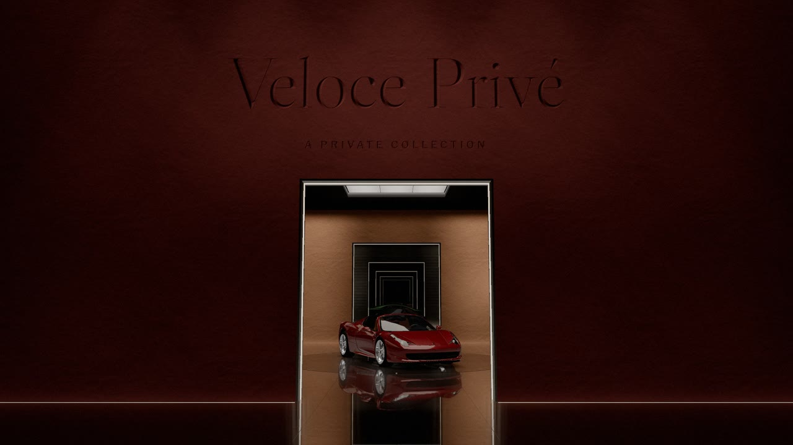
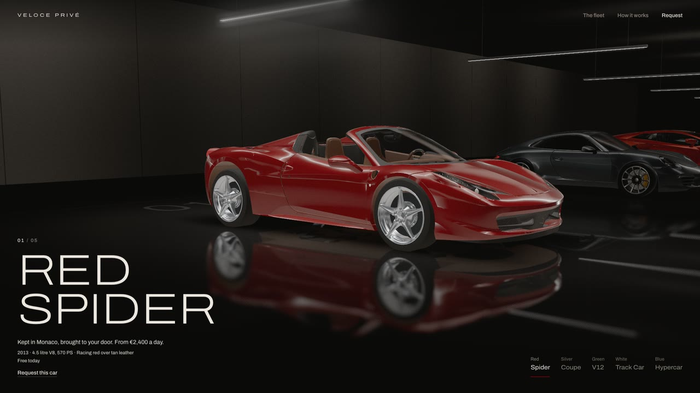
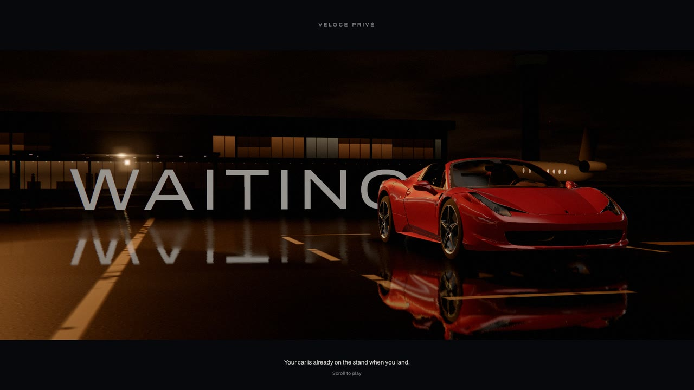

# Veloce Privé, the free pack

Three landing pages for a made-up supercar gallery, built with Claude Code and three.js, and the prompt sheet for every film made for its walls. It goes with my video, [I Built a Supercar Showroom Website with Claude Code](https://youtu.be/t5j3mBPtLfU).

**Open it:** https://sam1983aing.github.io/veloce-prive-pack/



## What's inside

| Page | Folder | What it is |
|---|---|---|
| The gallery | `gallery/` | The page from the video. Six rooms down one hall, a car on a turntable in each and a film on every wall. You walk through it by scrolling. |
| Concept 1, The Showroom | `concept-1/` | Five of the cars as a fleet you flick through, each one under the lights with its price. |
| Concept 3, Waiting | `concept-3/` | Your car is already on the stand when your jet lands. Scroll and the page plays like a short film. |
| Room films sheet | `room-films/` | Every film made for the walls: the exact prompt, the settings, the model and the credit cost. |

| | |
|---|---|
|  |  |

## Run it on your computer

You need [Node.js](https://nodejs.org) 20 or newer.

```bash
npm install
npm run dev
```

Then open the address it prints, ending in `/veloce-prive-pack/`. The pages are made for a laptop or a desktop. `npm run build` puts the finished site in `dist/`, and `npm run preview` serves it.

## The films aren't in the pack

The gallery plays a film on the wall of each room and a trailer before you walk in. The films aren't part of this repo, so every wall shows a "Your film here" frame and the trailer button says "Enter the gallery".

To add your own, put 16:9 MP4s in `public/films` (`room-01.mp4` to `room-06.mp4`, and `trailer.mp4`) and list them in `public/films/films.json`. The page only asks for the files you list. The prompts I used for mine are on the room films sheet.

## How it's put together

- **One Vite project, five pages.** `vite.config.js` lists them, and `base` is the address on GitHub Pages (`/veloce-prive-pack/`).
- **`src/gallery`** is the gallery: the scene and the scroll walk (`main.js`), the cars (`C2V3CarLoader.js`, `C2V3FleetData.js`), the rooms (`C2V3Showroom.js`), the films on the walls (`Projector.js`) and the way in (`Trailer.js`, `PlatinumButton.js`).
- **`src/concept-1` and `src/concept-3`** are the two concept pages, each with its own scene. Concept 1's engine sound is made in the browser (`src/audio`).
- **`src/shared`** reads `films.json`, and cuts the emblems out of the red spider's chrome as the concept pages load it.
- **`public/models`** holds the cars as `.glb` files and **`public/draco`** the decoder that unpacks them.
- **The names are made up.** The cars, their names and the gallery are fictional, and the makers' badges are taken out of the models. That's why the code calls the cars by neutral names like `redspider` and `silvercoupe`.

Built with [three.js](https://threejs.org), [GSAP](https://gsap.com) and [Lenis](https://lenis.darkroom.engineering), with fonts from Google Fonts.

## Put up your own copy

Fork the repo, change `base` in `vite.config.js` to your repo's name, then in your repo's Settings, Pages, set the source to GitHub Actions. The workflow in `.github/workflows/deploy.yml` builds and publishes the site on every push to `main`.

## Credits

Car models, each under its own licence, repainted and adjusted for these pages:

- **Room 01, the red spider:** by vicent091036, from the [three.js examples](https://threejs.org/examples/#webgl_materials_car).
- **Room 02, the silver coupe:** by [Lionsharp Studios](https://sketchfab.com/lionsharp) on [Sketchfab](https://sketchfab.com/3d-models/free-porsche-911-carrera-4s-d01b254483794de3819786d93e0e1ebf), [CC BY-SA 4.0](https://creativecommons.org/licenses/by-sa/4.0/). The adjusted model here is shared under the same licence.
- **Room 03, the green V12:** from moizahmad418's [3D configurator](https://github.com/moizahmad418/aventador-3d-configurator) on GitHub.
- **Room 04, the yellow wedge:** by [Artem P](https://sketchfab.com/temp0.crazy) on [Sketchfab](https://sketchfab.com/3d-models/lamborghini-gallardo-2010-ff0eb2242d0e42eb8b7034b4db639e56), [CC BY 4.0](https://creativecommons.org/licenses/by/4.0/).
- **Room 05, the white track car:** by [Black Snow](https://sketchfab.com/BlackSnow02) on [Sketchfab](https://sketchfab.com/3d-models/mclaren-senna-free-ea3e43a6eb004853a87fe9c58422eb96), [CC BY 4.0](https://creativecommons.org/licenses/by/4.0/).
- **Room 06, the blue hypercar:** by [DevPoly3D](https://sketchfab.com/DevPoly3D) on [Sketchfab](https://sketchfab.com/3d-models/bugatti-veyron-racing-car-unityunreal-8517e3271613487ca1cb37832ff54669), [CC BY 4.0](https://creativecommons.org/licenses/by/4.0/).

The films were made with Higgsfield (Seedance 2.5, Kling 4.0 and Cinema Studio 4.0), and you can see them in the video.

## Find me

[X](https://x.com/SammmAing) · [LinkedIn](https://www.linkedin.com/in/samnang-aing-639168341/) · [Threads](https://www.threads.com/@prompting_lab/) · [Instagram](https://www.instagram.com/samnang.aing/) · [YouTube](https://youtu.be/t5j3mBPtLfU)
